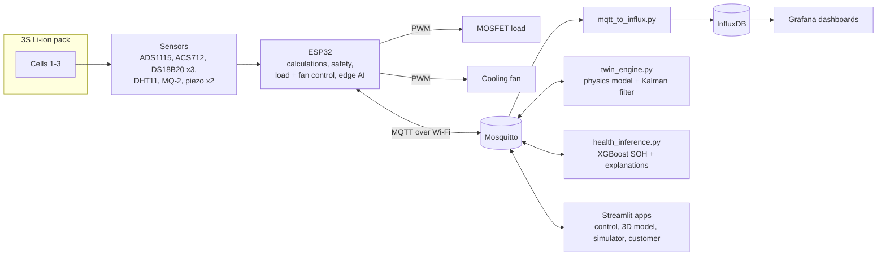

# EV Battery Health Monitoring System

An AI-powered battery monitoring system with a live digital twin. A single ESP32 watches a 3-cell Li-ion pack (cell voltages, current, cell and ambient temperature, gas and swelling), calculates its state of charge, health and remaining life, and cuts the load when something becomes unsafe. On the laptop, the data streams through MQTT into InfluxDB and Grafana, where a physics model, a Kalman filter and an XGBoost health estimator run alongside the real pack.

> Student project by **Team HAKD**, built as part of our VAC course. Won **2nd prize** at the college project expo.

---

## Features

- **Multi-sensor monitoring**: 3 cell voltages (ADS1115), pack current (ACS712-30A), 3 cell temperatures (DS18B20), ambient temperature/humidity (DHT11), gas (MQ-2), swelling (2 piezo discs)
- **On-board battery calculations**: SOC, SOH, RUL, SOE / SOF / SOP, internal resistance, cell imbalance, thermal gradient, dT/dt, thermal-runaway risk score, current limits
- **Safety**: over/under-voltage, over-temperature, gas and dT/dt cut-off, done directly on the ESP32
- **Active control**: closed-loop MOSFET variable load and a temperature-driven PWM cooling fan
- **Digital twin**: equivalent-circuit battery model + Kalman filter that tracks SOC and learns internal resistance, with a resistance-jump alarm that limits the load and raises the fan by itself
- **AI health estimator**: XGBoost model that estimates state of health from discharge voltage, temperature and cycle count, without a full capacity test, with an explanation of every estimate
- **Edge AI**: the same trained model is exported to C and runs on the ESP32
- **Dashboards**: three Grafana modes (Live digital twin, AI health demo, What-if simulator), a 3D model, a control panel and a customer app

## System architecture



More detail in [`docs/architecture.md`](docs/architecture.md).

## Repository layout

The Python programs sit together in the top folder because `start_all.py` launches them from there and they share modules.

| Path | What it is |
|---|---|
| `start_all.py` | Starts everything: Docker containers and every program below, each in its own window |
| `docker-compose.yml`, `mosquitto.conf` | Mosquitto, InfluxDB and Grafana |
| `mqtt_to_influx.py` | Bridge: copies MQTT messages into InfluxDB and a daily CSV log |
| `twin_engine.py`, `battery_model.py`, `kalman_soc.py` | Digital twin: equivalent-circuit model, Kalman filter, resistance-jump alarm |
| `health_ai.py`, `train_health_model.py`, `health_inference.py` | AI layer: training, validation and live health estimation |
| `export_model_to_c.py` | Converts the trained model into `health_model.h` for the ESP32 |
| `demo_nasa_replay.py` | AI demo: replays a NASA battery the model never saw |
| `fake_publisher.py` | Simulated pack for testing without hardware |
| `control.py`, `simulator.py`, `app.py`, `app_user.py` | Streamlit apps: control panel, what-if simulator, 3D model, customer app |
| `build_*.py`, `dash_style.py`, `fix_dashboards.py`, `fonts/` | Generate and repair the Grafana dashboards |
| `grafana/provisioning/` | Datasource and dashboards, loaded by Grafana on start-up |
| `cell_test_report.py`, `test_kalman.py`, `my_cells_template.csv` | Testing your own cells and the Kalman filter |
| `nasa_battery_cycles.csv` | Training data (NASA battery ageing dataset, per-cycle summary) |
| `firmware/EV_SINGLE_ESP32/` | Current ESP32 firmware (Rev B) |
| `firmware/_old_two_board/` | Earlier two-ESP32 firmware, kept for reference |
| `hardware/` | Wiring and PCB files |
| `docs/` | Architecture, sensors and parameters, product board rationale, full operating guide |

## Getting started

### Requirements
- Python 3.10+
- Docker Desktop
- Arduino IDE with the ESP32 board package

### 1. Install Python libraries

```bash
python -m pip install -r requirements.txt
```

### 2. Run without hardware

```bash
python start_all.py sim
```

The first start trains the AI model (10–20 s). Then open:

| What | Address |
|---|---|
| Grafana (expo view) | http://localhost:3000/d/ev-battery-twin?kiosk&theme=light |
| What-if simulator | http://localhost:8502 |
| Control panel | http://localhost:8503 |
| 3D model | http://localhost:8504 |
| Customer app | http://localhost:8505 |

Other modes: `python start_all.py demo` (AI demo on NASA battery B0005) and `python start_all.py fault` (rehearse the resistance-jump alarm).

### 3. Flash the ESP32

1. Run `python train_health_model.py` once. It writes `firmware/EV_SINGLE_ESP32/health_model.h`, which the firmware needs.
2. Open `firmware/EV_SINGLE_ESP32/EV_SINGLE_ESP32.ino` in the Arduino IDE.
3. At the top, set `WIFI_SSID`, `WIFI_PASSWORD` and `MQTT_HOST` (your PC's IP on the same Wi-Fi).
4. Check `ACS712_SENS_V_PER_A` matches your sensor (30A = 0.066).
5. Install libraries: Adafruit ADS1X15, OneWire, DallasTemperature, DHT sensor library, PubSubClient, ArduinoJson.
6. Upload, open the Serial Monitor at 115200 baud, then run `python start_all.py`.

The full guide, including testing your own cells and retraining, is in [`docs/operating-guide.txt`](docs/operating-guide.txt).

## Prototype hardware

| Function | Part | ESP32 pin |
|---|---|---|
| Cell voltages | ADS1115 + dividers (100k/100k, 220k/100k, 330k/100k) | I2C SDA 21, SCL 22 |
| Current | ACS712-30A (66 mV/A) | GPIO35 |
| Cell temperature | DS18B20 × 3, on 3.3 V | GPIO19 |
| Ambient | DHT11 | GPIO2 |
| Swelling | Piezo × 2 | GPIO36, GPIO39 |
| Gas | MQ-2 | GPIO34 |
| Load | MOSFET, PWM 5 kHz | GPIO13 |
| Cooling fan | PWM 25 kHz | GPIO25 |

All analog inputs are on ADC1, because ADC2 doesn't work reliably while Wi-Fi is on.

## AI model

| | |
|---|---|
| Model | XGBoost regressor, 300 trees, depth 3, learning rate 0.05 |
| Inputs | Mean discharge voltage, mean cell temperature, cycle count |
| Output | State of health (%) |
| Data | NASA battery ageing dataset: 11 batteries, ≥ 60 cycles each |
| Validation | Leave-one-battery-out (every battery is tested by a model that never saw it) |
| Demo | Battery B0005 is held out of the deployed model and replayed live |

`train_health_model.py` writes `validation_report.txt` and `validation_report.png` with the accuracy on each unseen battery. Known limits: it is trained on NASA's 2 Ah lab cells at constant current; our own cells need their own capacity tests (`--extra my_cells.csv`) before the estimate can be trusted on them.

## Product board (rev A.1)

The next step is a single 4-layer board with a TI BQ76952 battery monitor (3–16 cells, hardware protection, shunt-based coulomb counter) and an ESP32-S3. Part-by-part rationale: [`docs/bms-revA1-why-each-part.md`](docs/bms-revA1-why-each-part.md).

## Roadmap

- [x] Multi-sensor prototype on a single ESP32
- [x] MQTT → InfluxDB → Grafana digital twin with Kalman filter
- [x] XGBoost health estimator, also running on the ESP32
- [ ] Calibrate current and temperature readings against a multimeter
- [ ] Capacity-test our own cells and retrain
- [ ] CAN bus communication
- [ ] Rev A.1 PCB fabrication and bring-up
- [ ] TLS and authentication for MQTT

## Security note

The InfluxDB token, the Grafana admin password and the customer-app demo login in this repo are **local development defaults**. The stack is meant to run on your own laptop and Wi-Fi. Change them before running it on a shared or public network.

## Team

Built by **Team HAKD**.

| Name | Role |
|---|---|
| Dejas Sri | Hardware |
| Harine P U | Hardware and PCB design |
| Kaniha V | Software |
| Ashica A | Software |

## License

Code: MIT, see [LICENSE](LICENSE). Fonts in `fonts/` are under the SIL Open Font License (see the OFL files there).

## Acknowledgements

- NASA Prognostics Center of Excellence, Li-ion Battery Aging Dataset (Saha & Goebel, 2007)
- Texas Instruments BQ76952 reference designs
