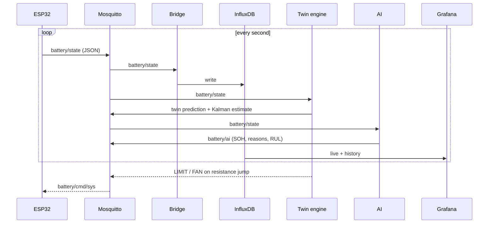

# System architecture

## Programs

| Program | Role |
|---|---|
| ESP32 firmware | Reads sensors, calculates SOC/SOH/RUL and the other parameters, runs safety cut-off, load and fan control, edge AI; publishes `battery/state` |
| Mosquitto | MQTT broker (1883 for devices and Python, 9001 WebSockets for browsers) |
| `mqtt_to_influx.py` | Stores every message in InfluxDB and a daily CSV in `data/` |
| `twin_engine.py` | Runs the equivalent-circuit model and Kalman filter beside the real pack; raises a resistance-jump alarm and sends `LIMIT` / `FAN` commands back |
| `health_inference.py` | Live AI: estimates SOH, explains it and projects cycles left; publishes `battery/ai` |
| Grafana | Three dashboard modes reading from InfluxDB |
| Streamlit apps | Control panel (8503), what-if simulator (8502), 3D model (8504), customer app (8505) |

## Data flow

## MQTT commands to the ESP32

| Topic | Command | Effect |
|---|---|---|
| `battery/cmd/load` | `<amps>` | Load current set-point |
| `battery/cmd/sys` | `STOP`, `CAL`, `ZERO`, `CYCLE` | Stop load, calibrate current sensor, reset SOC, mark cycle done |
| `battery/cmd/sys` | `LIMIT:<amps>` / `LIMIT:OFF` | Cap the load current |
| `battery/cmd/sys` | `FAN:<0-100>` / `FAN:AUTO` | Fan override / temperature curve |
| `battery/cmd/sys` | `SYNC` | Reset SOC from resting voltage |
| `battery/cmd/sys` | `DEMO_ON` / `DEMO_OFF` | Demo mode (sent by the replay and simulator) |

## SOC, SOH and RUL are three different problems

| Quantity | Question | Method |
|---|---|---|
| SOC | How much charge is left? | Coulomb counting on the ESP32; Kalman filter on the laptop corrects drift with the measured voltage |
| SOH | How degraded is it? | Measured capacity vs. baseline; XGBoost estimate from voltage, temperature and cycle count |
| RUL | When will it reach 80 %? | (SOH − 80 %) / degradation rate per cycle |

## Prototype → product

The product board (rev A.1) moves to a BQ76952 battery monitor and a single ESP32-S3. See [`bms-revA1-why-each-part.md`](bms-revA1-why-each-part.md).
